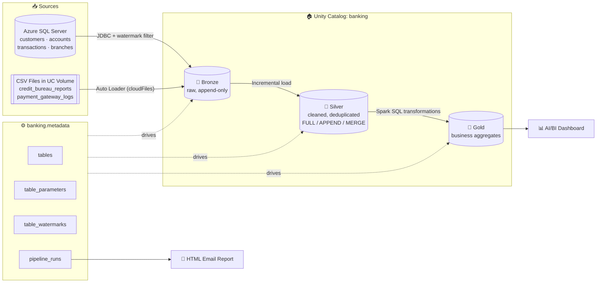
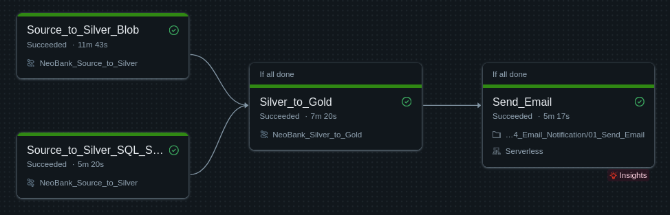
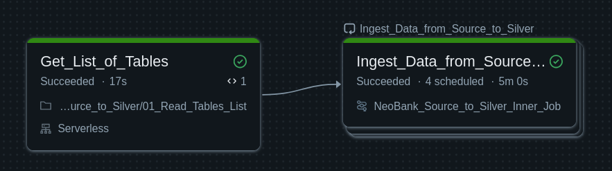
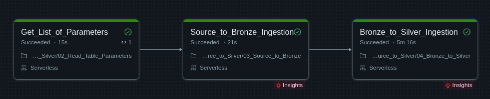
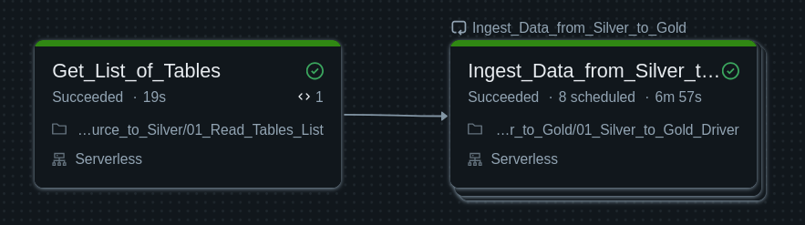
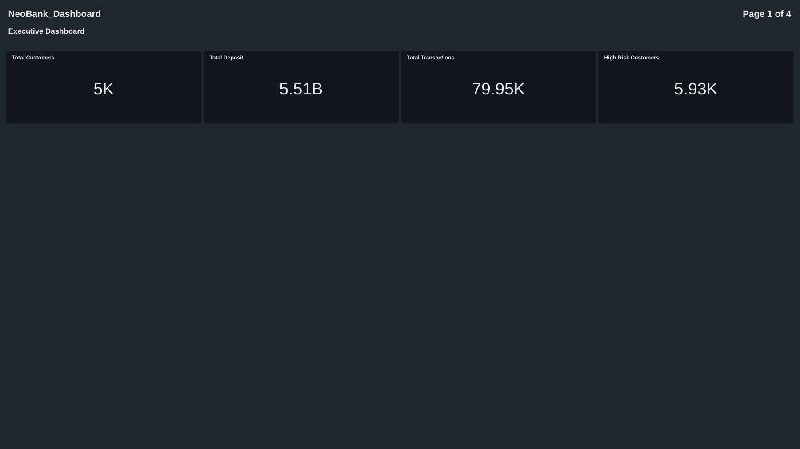
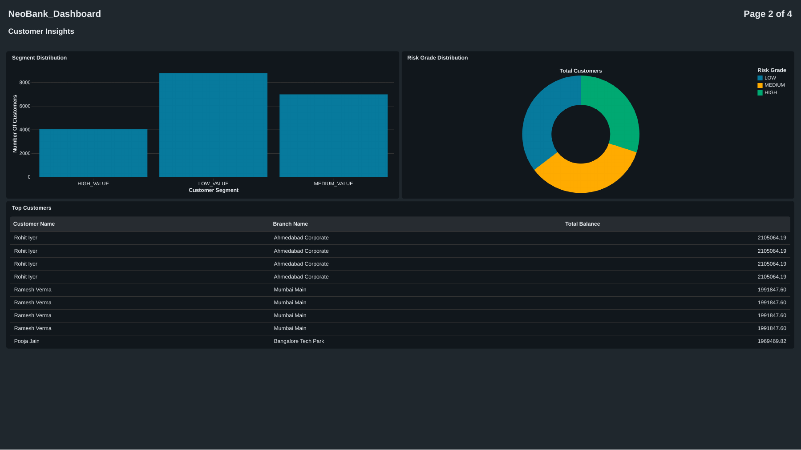
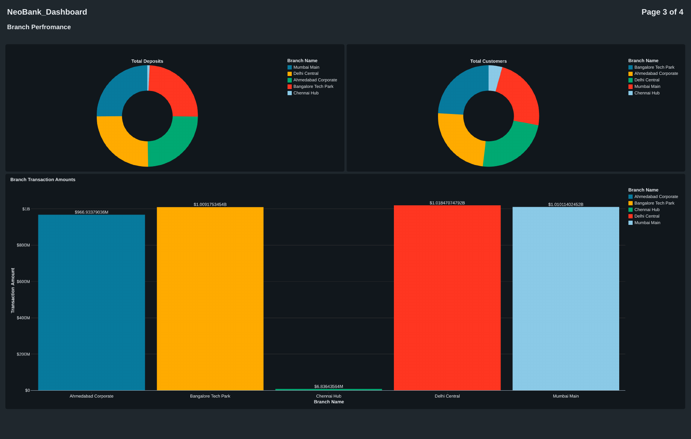
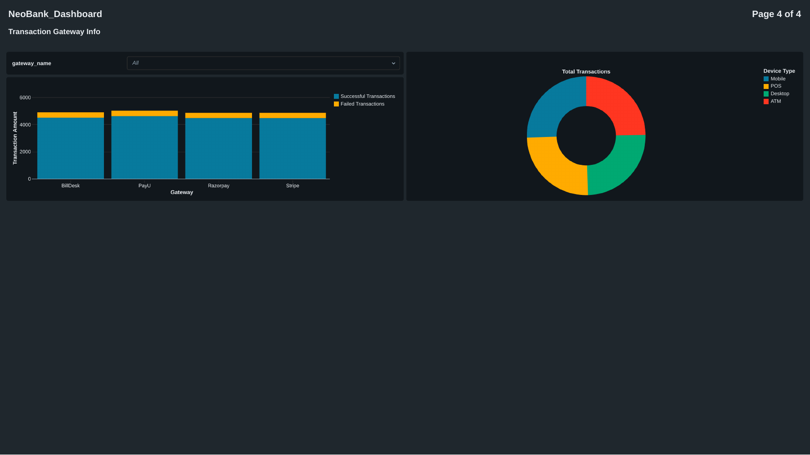
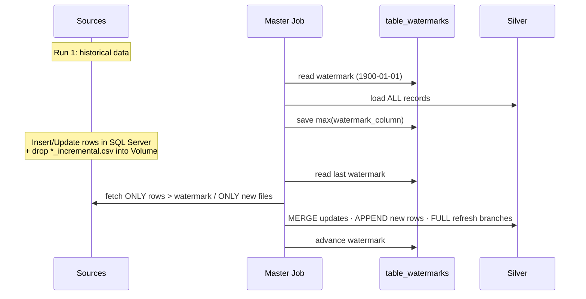

<div align="center">

# 🏦 NeoBank: End-to-End Banking Data Lakehouse on Databricks with Unity Catalog

**A metadata-driven, incremental, fully automated Medallion Lakehouse for the finance domain**


</div>

---

## 📌 Table of Contents

1. [Project Overview](#-project-overview)
2. [Business Problem](#-business-problem)
3. [Architecture](#-architecture)
4. [Tech Stack](#-tech-stack)
5. [Repository Structure](#-repository-structure)
6. [Data Sources](#-data-sources)
7. [Step-by-Step Implementation](#-step-by-step-implementation)
   - [Step 1: Prepare the Source Systems](#step-1--prepare-the-source-systems)
   - [Step 2: Set Up Unity Catalog & the Metadata Framework](#step-2--set-up-unity-catalog--the-metadata-framework)
   - [Step 3: Secure Credentials with a Secret Scope](#step-3--secure-credentials-with-a-secret-scope)
   - [Step 4: Source → Bronze Ingestion](#step-4--source--bronze-ingestion)
   - [Step 5: Bronze → Silver (Incremental Loads)](#step-5--bronze--silver-incremental-loads)
   - [Step 6: Silver → Gold (Business Aggregates)](#step-6--silver--gold-business-aggregates)
   - [Step 7: Orchestration with Databricks Jobs](#step-7--orchestration-with-databricks-jobs)
   - [Step 8: Automated Email Notifications](#step-8--automated-email-notifications)
   - [Step 9: Databricks AI/BI Dashboard](#step-9--databricks-aibi-dashboard)
8. [Incremental Load Demo](#-incremental-load-demo)
9. [Key Features](#-key-features)
10. [How to Run This Project](#-how-to-run-this-project)
11. [What I Learned](#-what-i-learned)
12. [Future Improvements](#-future-improvements)

---

## 🚀 Project Overview

**NeoBank** is a fictional digital bank. This project builds its complete analytics platform on **Databricks** as a **Lakehouse**, using the **Medallion Architecture (Bronze → Silver → Gold)**, with **Unity Catalog** handling governance.

Data comes from **two different kinds of sources**:

- 🗄️ **Azure SQL Server (OLTP)**: customers, accounts, transactions, branches
- 📁 **Cloud file storage (CSV files)**: credit bureau reports, payment gateway logs

The pipeline doesn't hardcode one notebook per table. It is **metadata-driven**: every table, its load strategy (`FULL` / `APPEND` / `MERGE`), primary key, and watermark column are stored in **control tables**. To onboard a new table, you add a row to the metadata. You don't write new code.

Databricks Workflows runs the whole flow end to end. Every run is audited, the team gets an **HTML email report** after each run, and the Gold data feeds a **Databricks AI/BI Dashboard**.

---

## 💼 Business Problem

Banks keep their data in separate systems. Core banking data sits in a relational database, while third-party data (credit bureaus, payment gateways) arrives as files. Leadership needs answers like:

- How many customers do we have, and how much do they deposit?
- Which customers are **high value**, and which are **high risk**?
- How is each **branch** performing?
- Which **payment gateways and devices** fail most often?

This project brings all of that data into one governed Lakehouse and loads only the new or changed records on each run. That keeps runs fast and cheap.

---

## 🏛️ Architecture



### Unity Catalog Layout

```
banking                      ← Catalog
├── metadata                 ← Control & audit tables
│   ├── tables
│   ├── table_parameters
│   ├── table_watermarks
│   └── pipeline_runs
├── source
│   └── volume               ← UC Volume (landing zone for CSV files)
├── bronze                   ← Raw data + insert_timestamp
├── silver                   ← Cleaned, upserted data + audit columns
└── gold                     ← Business-ready tables for BI
```

---

## 🧰 Tech Stack

| Category | Technology |
|---|---|
| **Platform** | Databricks (Serverless compute) |
| **Governance** | Unity Catalog (Catalog, Schemas, Volumes) |
| **Storage Format** | Delta Lake |
| **Processing** | PySpark, Spark SQL |
| **File Ingestion** | Databricks Auto Loader (`cloudFiles`) with `availableNow` trigger |
| **DB Ingestion** | Spark JDBC (Microsoft SQL Server driver) |
| **Source Database** | Azure SQL Server |
| **Orchestration** | Databricks Workflows (Jobs, For Each tasks, Task Values, Run-If conditions) |
| **Secrets** | Databricks Secret Scope (created through the REST API) |
| **Alerting** | Python `smtplib` + Gmail SMTP (HTML email) |
| **Visualization** | Databricks AI/BI (Lakeview) Dashboard |

---

## 📂 Repository Structure

```
.
├── 00_Source_Files/
│   ├── 01_SQL_Server/
│   │   ├── 01_Create_Tables.sql            # DDL for banking schema in Azure SQL
│   │   ├── 02_Insert_Historical_data.sql   # Initial (historical) load data
│   │   └── 03_Incrementat_data.sql         # New + updated records for incremental demo
│   └── 02_Blob/
│       ├── credit_bureau_reports_1.csv               # Historical file
│       ├── credit_bureau_reports_2_incremental.csv   # Incremental file
│       ├── payment_gateway_logs_1.csv                # Historical file
│       └── payment_gateway_logs_2_incremental.csv    # Incremental file
│
├── 01_Setup_Metadata/
│   ├── 01_Setup_Metadata.sql      # Catalog, schemas, volume & metadata tables + seed data
│   └── 02_Check_Metadata.sql      # Handy queries to inspect metadata/audit tables
│
├── 02_Source_to_Silver/
│   ├── 00_Setup_Secret_Scope.py   # Creates secret scope & stores credentials via REST API
│   ├── 01_Read_Tables_List.py     # Reads active tables for a source system → Task Value
│   ├── 02_Read_Table_Parameters.py# Reads load_type / PK / watermark for a table → Task Value
│   ├── 03_Source_to_Bronze.py     # JDBC / Auto Loader ingestion into Bronze
│   └── 04_Bronze_to_Silver.py     # FULL / APPEND / MERGE into Silver + watermark update
│
├── 03_Silver_to_Gold/
│   ├── 01_Silver_to_Gold_Driver.py         # Generic driver: audits & runs a Gold notebook
│   └── gold_transformations/
│       ├── customer_360.py
│       ├── branch_performance.py
│       ├── transaction_channel_summary.py
│       ├── daily_bank_kpi.py
│       └── risk_customer_summary.py
│
├── 04_Email_Notification/
│   └── 01_Send_Email.py           # Builds & sends HTML run report from audit table
│
├── 05_Dashboard/
│   ├── NeoBank_Dashboard.lvdash.json  # Importable Databricks AI/BI dashboard
│   ├── NeoBank_Dashboard.pdf          # Exported dashboard (all pages)
│   └── screenshots/                   # PNG previews of each dashboard page
│
└── 06_Databricks_Jobs/            # Screenshots of the orchestration jobs
    ├── Master_Job.png
    ├── Source_to_Silver.png
    ├── Source_to_Silver_Inner_Job.png
    └── Silver_to_Gold.png
```

---

## 🗃️ Data Sources

### 1. Azure SQL Server: Core Banking (OLTP)

| Table | Description | Primary Key | Load Type | Watermark Column |
|---|---|---|---|---|
| `banking.customers` | Customer master data incl. KYC status & home branch | `customer_id` | **MERGE** (SCD1 upsert) | `updated_at` |
| `banking.accounts` | Savings / Current accounts & balances | `account_id` | **MERGE** | `updated_at` |
| `banking.transactions` | Debit/credit transactions with channel & status | `txn_id` | **APPEND** | `txn_timestamp` |
| `banking.branches` | Small reference table of branches | `branch_code` | **FULL** (overwrite) | none |

### 2. File Storage: Third-Party Feeds (CSV → UC Volume)

| Dataset | Description | Primary Key | Load Type | Watermark Column |
|---|---|---|---|---|
| `credit_bureau_reports` | Credit score, risk grade, external loans & overdue amounts | `customer_id` | **MERGE** | `bureau_pull_date` |
| `payment_gateway_logs` | Gateway name, status, response code, latency, device, location | `txn_id` | **APPEND** | `processed_timestamp` |

> [!NOTE]
> Each file dataset comes with a **historical** file and an **incremental** file, so the incremental behaviour of the pipeline can be tested end to end.

---

## 🛠️ Step-by-Step Implementation

### Step 1: Prepare the Source Systems

**Relational source (Azure SQL Server)**

1. Created an Azure SQL Database.
2. Ran [`01_Create_Tables.sql`](00_Source_Files/01_SQL_Server/01_Create_Tables.sql) to create the `banking` schema with `branches`, `customers`, `accounts` and `transactions`, including primary keys, foreign keys, and `created_at` / `updated_at` audit columns.
3. Ran [`02_Insert_Historical_data.sql`](00_Source_Files/01_SQL_Server/02_Insert_Historical_data.sql) to load the initial history.

**File source (CSV)**

4. Uploaded the historical CSV files into the Unity Catalog Volume:
   - `/Volumes/banking/source/volume/credit_bureau_reports/`
   - `/Volumes/banking/source/volume/payment_gateway_logs/`

---

### Step 2: Set Up Unity Catalog & the Metadata Framework

📄 [`01_Setup_Metadata.sql`](01_Setup_Metadata/01_Setup_Metadata.sql)

This is the core of the project. It creates the `banking` catalog, the `metadata` and `source` schemas, the landing **Volume**, and four **Delta control tables**:

| Control Table | Purpose |
|---|---|
| `metadata.tables` | Registry of every table: source system, source schema/table or file path, target layer, active flag and **load order** |
| `metadata.table_parameters` | Key-value config per table: `load_type`, `primary_key`, `watermark_column` |
| `metadata.table_watermarks` | Last successfully processed watermark value per table (seeded with `1900-01-01`) |
| `metadata.pipeline_runs` | **Audit log**: run ID, table, layer, start/end time, status, record count, error message |

Gold tables are registered in `metadata.tables` too (with `source_system = 'silver'` and `target_layer = 'gold'`), so the same framework drives every layer.

```sql
-- Example: how a table is configured
INSERT INTO banking.metadata.table_parameters VALUES
(1, 'load_type',        'MERGE',       current_timestamp()),
(1, 'primary_key',      'customer_id', current_timestamp()),
(1, 'watermark_column', 'updated_at',  current_timestamp());
```

> [!TIP]
> **Onboarding a new table is just a few `INSERT` statements.** No pipeline code needs to change.

---

### Step 3: Secure Credentials with a Secret Scope

📄 [`00_Setup_Secret_Scope.py`](02_Source_to_Silver/00_Setup_Secret_Scope.py)

No credentials are hardcoded in the pipeline notebooks. This notebook:

1. Builds a JSON object with the SQL Server host, port, database, user, password and JDBC driver.
2. Calls the **Databricks REST API** (`/api/2.0/secrets/scopes/create`) to create the `banking-scope` secret scope.
3. Stores the connection JSON as a single secret (`sqlserver-connection-json`) and the Gmail app password (`gmail_api_key`) through `/api/2.0/secrets/put`.
4. Checks that the secrets can be read back with `dbutils.secrets.get()`.

---

### Step 4: Source → Bronze Ingestion

📄 [`01_Read_Tables_List.py`](02_Source_to_Silver/01_Read_Tables_List.py) → [`02_Read_Table_Parameters.py`](02_Source_to_Silver/02_Read_Table_Parameters.py) → [`03_Source_to_Bronze.py`](02_Source_to_Silver/03_Source_to_Bronze.py)

1. **Get the list of tables:** Takes a `source_system` parameter (`sqlserver` / `blob`), reads the active tables from `metadata.tables` ordered by `load_order`, and publishes them as a **Databricks Task Value** (`tables_metadata`).
2. **Get the parameters for each table:** Inside a **For Each** loop, reads that table's config from `metadata.table_parameters` and publishes it as the `table_parameters` Task Value.
3. **Ingest into Bronze:**
   - Writes an `INPROGRESS` row to `pipeline_runs`, or updates the existing row when a run is repaired.
   - **SQL Server:** reads the last watermark and pushes the filter down to the database through JDBC:
     ```sql
     (SELECT * FROM banking.customers WHERE updated_at > '<last_watermark>') AS src
     ```
   - **CSV files:** uses **Auto Loader** (`cloudFiles`) with schema inference, a checkpoint location, and `trigger(availableNow=True)`. New files are picked up exactly once, and the stream runs like a batch job.
   - Adds an `insert_timestamp` column and **appends** to `banking.bronze.<table>`.
   - On failure, marks the audit row `FAILED`, saves the error message, and re-raises the exception so the job fails visibly.

> [!IMPORTANT]
> The watermark is **not** updated at the Bronze stage. It only moves forward after Silver loads successfully, so a failed run never skips data.

---

### Step 5: Bronze → Silver (Incremental Loads)

📄 [`04_Bronze_to_Silver.py`](02_Source_to_Silver/04_Bronze_to_Silver.py)

The notebook reads the Bronze rows that are newer than the stored watermark and applies the load strategy set in the metadata:

| Load Type | Behaviour | Used For |
|---|---|---|
| **FULL** | `overwrite` the Silver table (with `overwriteSchema`) | `branches` |
| **APPEND** | Append only new rows | `transactions`, `payment_gateway_logs` |
| **MERGE** | Delta Lake `MERGE` on the primary key: update when matched, insert when not matched (SCD Type 1) | `customers`, `accounts`, `credit_bureau_reports` |

```python
delta_table.alias("t").merge(
    bronze_df.alias("s"), f"t.{primary_key} = s.{primary_key}"
).whenMatchedUpdateAll().whenNotMatchedInsertAll().execute()
```

After a successful write:
- The **max value of the watermark column** is written back to `metadata.table_watermarks` (a `MERGE` upsert).
- In a `try / except / finally` block, the `pipeline_runs` audit row is updated with `SUCCESS` / `FAILED`, the end time, the number of records, and any error message.
- The Silver table is created automatically on the first run, and the `insert_timestamp` / `update_timestamp` audit columns are added.

---

### Step 6: Silver → Gold (Business Aggregates)

📄 [`01_Silver_to_Gold_Driver.py`](03_Silver_to_Gold/01_Silver_to_Gold_Driver.py) + [`gold_transformations/`](03_Silver_to_Gold/gold_transformations)

A **single generic driver notebook** gets the table metadata, logs an audit entry, and then dynamically runs `gold_transformations/<table_name>` with `dbutils.notebook.run()`. Each Gold notebook returns its row count through `dbutils.notebook.exit()`, and the driver records it in the audit table.

| Gold Table | What It Answers | Highlights |
|---|---|---|
| 🧑‍💼 **`customer_360`** | Single view of every customer | Joins customers, accounts, transactions, branches & the **latest** credit report (`ROW_NUMBER()` window). Segments customers into `HIGH_VALUE` (≥ 500K), `MEDIUM_VALUE` (≥ 100K) and `LOW_VALUE` |
| 🏢 **`branch_performance`** | How each branch performs | Customers, accounts, total deposits, transaction count & amount per branch |
| 💳 **`transaction_channel_summary`** | Payment gateway health | Daily successful vs failed transactions & avg processing time by gateway and device |
| 📈 **`daily_bank_kpi`** | Executive daily KPIs | Daily transaction volume plus bank-wide customers, accounts, balance, avg credit score & high-risk count |
| ⚠️ **`risk_customer_summary`** | Credit risk exposure | Customers, avg credit score, external loans & overdue amounts per risk grade |

---

### Step 7: Orchestration with Databricks Jobs

The pipeline is fully automated with **Databricks Workflows**, using a **modular, nested-job design** on **Serverless** compute.

#### 🎯 Master Job: `NeoBank_Master`

<p align="center"></p>

- **`Source_to_Silver_Blob`** and **`Source_to_Silver_SQL_Server`** run **in parallel**. Both call the same reusable `NeoBank_Source_to_Silver` job, each with a different `source_system` parameter.
- **`Silver_to_Gold`** starts after both ingestion tasks finish.
- **`Send_Email`** uses the **"If all done"** run condition. It runs whether upstream tasks succeed or fail, so the team always gets a report.

#### 🔁 `NeoBank_Source_to_Silver` Job

<p align="center"></p>

- **`Get_List_of_Tables`** emits the list of active tables as a Task Value.
- **`Ingest_Data_from_Source_to_Silver`** is a **For Each** task that loops over that list and starts the inner job once per table. Tables are processed concurrently.

#### 🧩 `NeoBank_Source_to_Silver_Inner_Job` (one run per table)

<p align="center"></p>

`Get_List_of_Parameters` ➜ `Source_to_Bronze_Ingestion` ➜ `Bronze_to_Silver_Ingestion`

#### 🥇 `NeoBank_Silver_to_Gold` Job

<p align="center"></p>

- **`Get_List_of_Tables`** (with `source_system = silver`) returns the Gold tables registered in the metadata.
- **`Ingest_Data_from_Silver_to_Gold`** is a **For Each** task that runs the Gold driver notebook for every Gold table.

> [!NOTE]
> The master job's **run ID** is passed down to every child task. All audit records from one end-to-end run share the same `run_id`, which the email report uses to summarize the run.

---

### Step 8: Automated Email Notifications

📄 [`01_Send_Email.py`](04_Email_Notification/01_Send_Email.py)

When the pipeline finishes, this notebook:

1. Queries `metadata.pipeline_runs` (joined with `metadata.tables`) for the current `run_id`.
2. Sets the **overall status**: `FAILED` if any table failed, otherwise `SUCCESS`.
3. Turns the audit results into an **HTML table** (pandas `to_html`).
4. Sends an email with the subject **`NeoBank | <STATUS> | End to End Run`** through Gmail SMTP over SSL (port 465). The app password is read from the secret scope.

The stakeholder gets a per-table summary showing the layer, start/end time, status, record count and any error.

---

### Step 9: Databricks AI/BI Dashboard

📄 [`NeoBank_Dashboard.lvdash.json`](05_Dashboard/NeoBank_Dashboard.lvdash.json) · [`NeoBank_Dashboard.pdf`](05_Dashboard/NeoBank_Dashboard.pdf)

The Gold layer feeds a **4-page Databricks AI/BI dashboard**:

| Page | Visuals |
|---|---|
| **1. Executive Dashboard** | KPI counters: Total Customers, Total Deposits, Total Transactions, High-Risk Customers |
| **2. Customer Insights** | Customer segment distribution, risk grade donut, top customers by balance |
| **3. Branch Performance** | Deposits & customers by branch, transaction amount per branch |
| **4. Transaction Gateway Info** | Successful vs failed transactions per gateway (with filter), transactions by device type |

#### Page 1: Executive Dashboard


#### Page 2: Customer Insights


#### Page 3: Branch Performance


#### Page 4: Transaction Gateway Info


---

## 🔄 Incremental Load Demo

To show that the pipeline really is incremental:



1. **Run 1:** Load the historical SQL data and the `*_1.csv` files. Everything is loaded.
2. Run [`03_Incrementat_data.sql`](00_Source_Files/01_SQL_Server/03_Incrementat_data.sql), which inserts new customers/accounts/transactions and **updates** existing ones. Then upload the `*_2_incremental.csv` files to the Volume.
3. **Run 2:** Only the changed rows and the new files are processed. Updated customers and accounts are **merged** in place, new transactions are **appended**, and Auto Loader skips files it has already processed.
4. Check the results with [`02_Check_Metadata.sql`](01_Setup_Metadata/02_Check_Metadata.sql) by inspecting `pipeline_runs` and `table_watermarks`.

---

## ✨ Key Features

- ✅ **Metadata-driven framework:** add tables through configuration instead of code
- ✅ **Multi-source ingestion:** JDBC (Azure SQL) and Auto Loader (cloud files)
- ✅ **Watermark-based incremental processing** with filters pushed down to the source
- ✅ **Three load strategies:** FULL, APPEND and MERGE (SCD Type 1 upserts with Delta Lake)
- ✅ **Unity Catalog governance:** catalog → schema → table, plus Volumes for files
- ✅ **End-to-end audit trail** for every table, layer and run
- ✅ **Failure-safe design:** watermarks move only after Silver succeeds, failures are logged and re-raised, and repaired runs update their audit rows in place
- ✅ **Reusable nested jobs** with **For Each** loops and parallel execution on **Serverless** compute
- ✅ **Secrets management:** no credentials in code
- ✅ **Automated HTML email reports** after every run
- ✅ **Business-ready Gold layer** and an **interactive AI/BI dashboard**

---

## ▶️ How to Run This Project

### Prerequisites
- A Databricks workspace with **Unity Catalog** enabled (Serverless compute recommended)
- An **Azure SQL Database** (or any SQL Server reachable from Databricks)
- A Gmail account with an **App Password** (for email alerts)

### Setup

1. **Clone the repo** and import the notebooks into your Databricks workspace (or use Databricks Git Folders).
2. **Source DB:** Run `00_Source_Files/01_SQL_Server/01_Create_Tables.sql`, then `02_Insert_Historical_data.sql`, on your SQL Server.
3. **Metadata:** Run `01_Setup_Metadata/01_Setup_Metadata.sql` in Databricks.
4. **Files:** Upload the historical CSVs to `/Volumes/banking/source/volume/credit_bureau_reports/` and `/Volumes/banking/source/volume/payment_gateway_logs/`.
5. **Secrets:** Fill in your connection details and Gmail app password in `02_Source_to_Silver/00_Setup_Secret_Scope.py`, then run it.
6. **Email:** Update the sender and receiver addresses in `04_Email_Notification/01_Send_Email.py`.
7. **Jobs:** Create the four jobs as shown in the [orchestration section](#step-7--orchestration-with-databricks-jobs):
   - `NeoBank_Source_to_Silver_Inner_Job`: parameters `table_metadata`, `run_id`
   - `NeoBank_Source_to_Silver`: parameters `source_system`, `run_id`
   - `NeoBank_Silver_to_Gold`: `source_system = silver`, `run_id`
   - `NeoBank_Master`: passes `{{job.run_id}}` down as `run_id`
8. **Run** the master job, then import `05_Dashboard/NeoBank_Dashboard.lvdash.json` into Databricks Dashboards.
9. *(Optional)* Load the incremental data and run the job again to see incremental processing in action.

---

## 🎓 What I Learned

- Designing a **reusable, configuration-driven** ingestion framework instead of writing separate pipelines for each table
- Implementing **watermark-based CDC** and the trade-offs between FULL, APPEND and MERGE loads
- Using **Delta Lake MERGE** for upserts and **Auto Loader** for exactly-once file ingestion
- Organizing data and files with **Unity Catalog** (catalogs, schemas, volumes)
- Building **nested, parameterized Databricks Workflows** with Task Values, For Each loops and Run-If conditions
- Building **observability** into a pipeline with audit tables and automated notifications
- Turning raw data into **business KPIs** and presenting them in a dashboard

---

## 🔮 Future Improvements

- [ ] Add **data quality checks** (e.g., Delta Live Tables expectations or Great Expectations)
- [ ] Implement **SCD Type 2** history for customers and accounts
- [ ] Apply **row/column-level security and PII masking** (e.g., PAN, email, phone) with Unity Catalog
- [ ] **CI/CD** with Databricks Asset Bundles and GitHub Actions
- [ ] Move alerting to Slack / Teams webhooks
- [ ] Make Gold tables incremental instead of `CREATE OR REPLACE`

---

<div align="center">

### ⭐ If you found this project useful, consider giving it a star!

</div>
